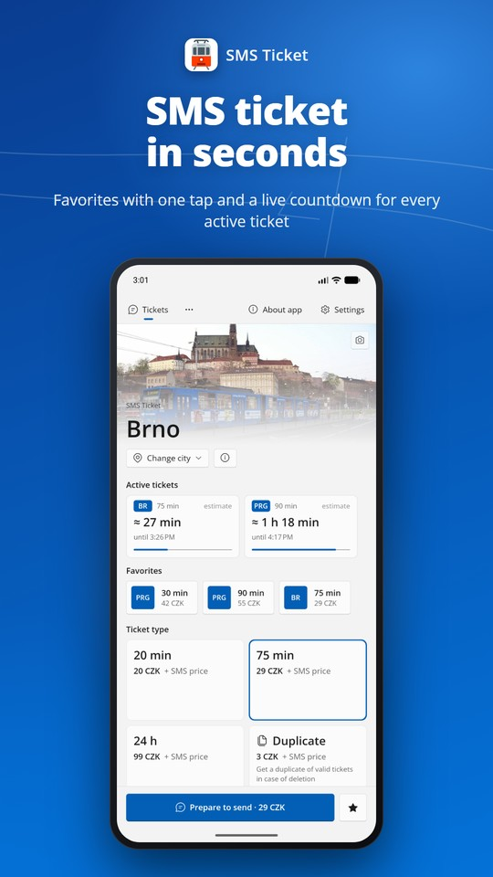
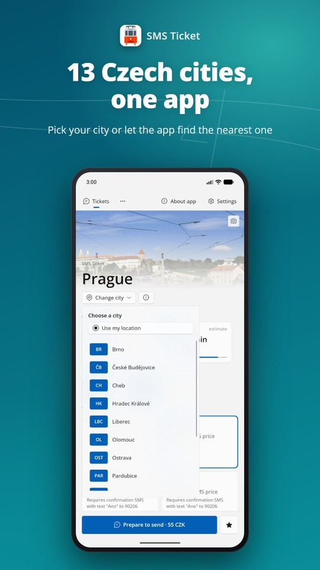
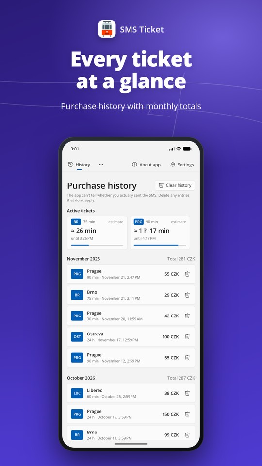
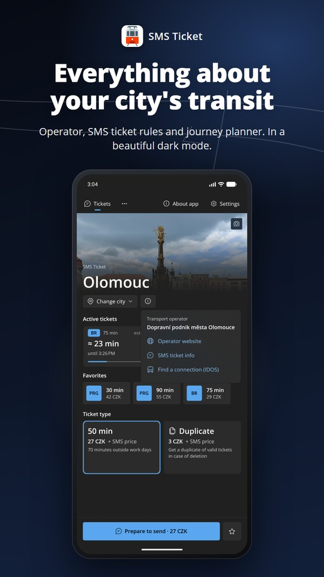
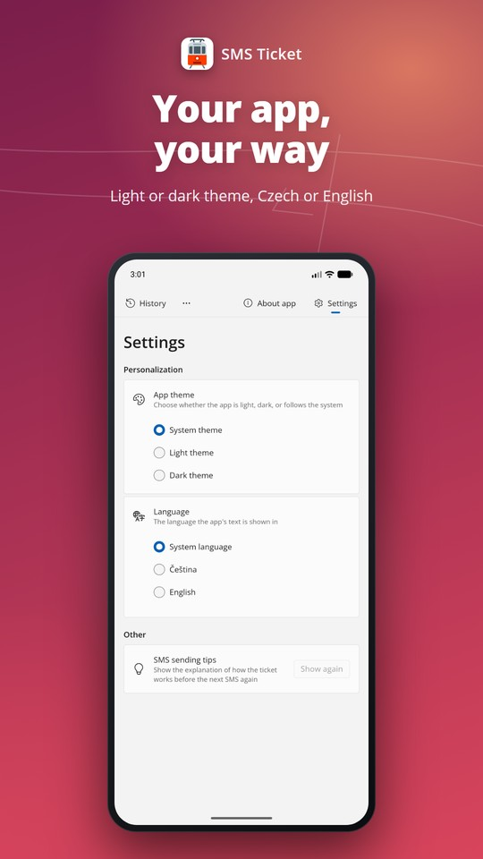

# SMS Ticket

Buy public transport tickets by SMS in Czech cities, without having to remember the numbers and codes. Pick your city and ticket, tap **Prepare to send**, and your messaging app opens with the SMS ready to go.

<a href="https://play.google.com/store/apps/details?id=com.sphereline.smsticketandroid">Get it on Google Play</a>

<p>
  
  
  
  
  
</p>

## Features

- SMS tickets for 13 cities, with prices and validity at a glance
- A photo of each city, so it's obvious which one you're buying for
- Duplicate tickets for when you've deleted the confirmation SMS
- Favorites for one-tap buying, also as home screen shortcuts
- Active tickets with a live countdown and a reminder before they expire
- Purchase history with monthly totals
- Paste or share the confirmation SMS to see the exact validity
- City info: transport operator, SMS ticket rules and journey planner links
- Optional nearest city detection
- Light, dark and high contrast themes, in Czech and English

The ticket SMS is charged by your operator: the ticket price plus the price of the SMS itself.

## Cities

Brno, Cheb, České Budějovice, Hradec Králové, Liberec, Olomouc, Ostrava, Pardubice, Plzeň, Praha, Tábor, Ústí nad Labem, Zlín and Otrokovice.

Prices and numbers live in [`data/tickets.json`](data/tickets.json). The app downloads the latest version from `main`, so a fix there reaches users without an app update. Spotted an outdated price or a missing city? [Open an issue](https://github.com/MartinZikmund/SmsTicket/issues/new) or send a pull request.

## Building

The app is built with [Uno Platform](https://platform.uno) and .NET, from a single project that targets Android, iOS, Windows, desktop (Skia) and WebAssembly.

1. Install the .NET SDK and run [`uno-check`](https://platform.uno/docs/articles/external/uno.check/doc/using-uno-check.html) to get the workloads.
2. Open `src/SmsTicket.slnx`, or build from the command line:

   ```bash
   dotnet build src/SmsTicket/SmsTicket.csproj -f net11.0-desktop
   dotnet test src/SmsTicket.Tests
   ```

Debug builds show Google's test ads. Release builds only show ads when the production ad unit IDs are provided, see [CI and releases](docs/CI.md).

## Credits

City photos come from Wikimedia Commons under Creative Commons licenses, see [ATTRIBUTIONS.md](ATTRIBUTIONS.md).

## License

[MIT](LICENSE)
